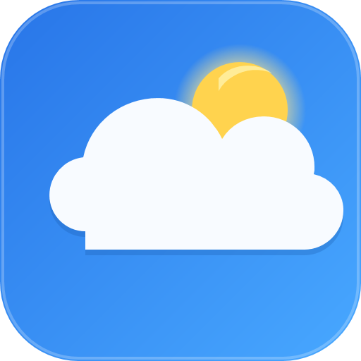
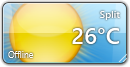
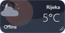

<p align="center">
  
</p>

<h1 align="center">WeatherWidget</h1>

<p align="center">The little weather widget I missed on Windows 11.</p>

<p align="center">
  
  
  
</p>

I got used to the weather gadgets in Windows 7 and later used XWidget to keep a forecast on my desktop. When its weather service stopped working, I wanted something that felt familiar and worked on Windows 11. So I made WeatherWidget: a small desktop app built with C#, WPF and .NET 10.

It sits where you leave it, shows the current weather, and opens a fuller forecast when you click it. There is a tray icon for quick access, and a separate Settings window for everything else.

## Download and run

[**Download the latest Windows x64 release**](https://github.com/mgracanin/WeatherWidget/releases/latest)

Extract the ZIP and run **WeatherWidget.exe**. Keep the **Assets** folder beside it. The .NET runtime is included, so you do not need to install the SDK or XWidget.

Right-click the card or tray icon and open **Settings…** to choose your location. Click **Apply** to save your changes. Your city, theme, sizes and other preferences are remembered the next time you run the app.

## Themes

Seven themes are included: **Modern, Classic, Aurora, Paper, Sunset, Nordic and Forest**. Each has weather and day/night scenes for both the small card and the expanded forecast. The previews below show sample weather.

| Modern | Classic | Aurora |
| --- | --- | --- |
|  |  |  |
| **Paper** | **Sunset** | **Nordic** |
|  |  |  |

**Forest**, with the temperature trend shown beside the current reading:


Modern and Classic have new, glass-inspired artwork. If you have your own Windows 7 gadget images, two more choices—**Legacy Modern** and **Legacy Classic**—can use them. The old images are optional and are not included in the download.

## Forecasts and reminders

Click the card to open the forecast:


- Current temperature and conditions, feels-like temperature, humidity and wind.
- The next 12 hours and a five-day forecast, with highs, lows and precipitation chances.
- A **Rain soon** indicator when rain is likely in the next few hours.
- A temperature trend for roughly three hours ahead: **↑ warming**, **↓ cooling**, **→ steady**.
- Optional rain, frost-risk and strong-wind reminders, with quiet hours you can set yourself.

Weather normally refreshes every 15 minutes. If the connection fails, the last forecast stays available with an offline label. Older readings are marked stale and eventually hidden. The trend arrow appears only when fresh forecast data is available.

Reminders are off by default. When enabled, each type is limited to one reminder every six hours; Windows notification settings can also silence them.

## Using Windows 7 gadget images

Use **Legacy Modern** or **Legacy Classic** for the old artwork. **Modern** and **Classic** always use the new artwork that comes with the app.

1. Find the `Weather.Gadget\images` folder on a Windows 7 installation. The usual path is:

   ```text
   C:\Program Files\Windows Sidebar\Gadgets\Weather.Gadget\images
   ```

2. Where your rights allow it, copy that image folder to your Windows 11 PC.
3. Open **Settings → Appearance → Optional legacy artwork → Import legacy images…**.
4. Select the copied `images` folder—or its parent `Weather.Gadget` folder.
5. Choose **Legacy Modern · local images** or **Legacy Classic · local images**, then click **Apply**.

The app copies the supported PNGs into your user profile and leaves the source folder alone. Missing images use the new artwork, so a partial set still works. Your imported images survive app updates.

Microsoft's artwork is not included with WeatherWidget. Access to Windows 7 and an attribution notice do not, by themselves, grant permission to reuse or redistribute it. Use only images you have the right to use.

[**Full import guide: other folder locations, manual copying and troubleshooting**](docs/legacy-artwork.md)

## Settings

| Section | What you will find |
| --- | --- |
| **Location & units** | City search, up to ten saved locations, Windows/IP location discovery, temperature and wind units, and Croatian/English language choices. |
| **Appearance** | Theme previews, separate card/forecast sizes, and the optional legacy image importer. |
| **Desktop** | Position lock, edge snapping, always-on-top and startup with Windows. |
| **Notifications** | Weather reminders and quiet hours, using your computer's local time. |

**Apply** saves and updates the widget. **Save and close** does the same and closes Settings. **Cancel**, Escape or × discards edits made since the last Apply. Reopen Settings after changing the language to update the window's labels.

For saved locations, choose a city and click **Save current**, then Apply. Only the selected location downloads a forecast. Location discovery runs when you ask for it: Windows uses its permission controls, while IP lookup gives an approximate city and may be wrong with a VPN or an ISP gateway. Review the result before applying it. [More about locations](docs/locations.md).

## Moving and resizing

| Action | Result |
| --- | --- |
| Click the card | Open or close the forecast. |
| Drag the card | Move it; the position is remembered. |
| Drag a lower-right corner | Resize either window without changing its proportions. |
| Ctrl + mouse wheel over the card | Change the card's size. |
| Drag the forecast header | Move the expanded view. |
| Escape, × or click outside the forecast | Close the forecast. |
| Double-click the tray icon | Bring the card back on screen. |
| Right-click → Exit | Quit the app. |

The card starts at **130 × 67** and the forecast at about **330 × 243**. Neither adds a taskbar button. Edge snapping is on by default; startup with Windows is off. You can change both in Settings.

## Data and privacy

Forecasts and city search come from [Open-Meteo](https://open-meteo.com/), with geocoding based on GeoNames. The selected location's coordinates are sent to the forecast service. An IP estimate contacts [ipapi.co](https://ipapi.co/) only when you choose that option. There is no background location tracking.

Preferences, saved locations and the weather cache are kept in `%LOCALAPPDATA%\WeatherWidget`. Imported artwork goes in its `LegacyArtwork` subfolder.

See [NOTICE.md](NOTICE.md) for provider terms and artwork credits, and the [artwork guide](docs/assets.md) for the difference between included and imported themes.

## Build from source

You need Windows and the [.NET 10 SDK](https://dotnet.microsoft.com/download/dotnet/10.0):

```powershell
git clone https://github.com/mgracanin/WeatherWidget.git
cd WeatherWidget
.\build.ps1 -Test -Publish
```

The portable app is written to `artifacts\win-x64`. Copy that folder's contents together when moving it to another PC. Close a copy running from that folder before publishing over it.

For a development build or just the checks:

```powershell
.\build.ps1
.\build.ps1 -Test
```

The script uses `tools\dotnet\dotnet.exe` if a local SDK is present; otherwise it uses the installed SDK. Tests use saved responses and temporary files. They do not request your location or change your preferences.
