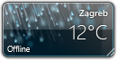
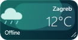
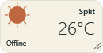
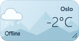
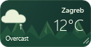
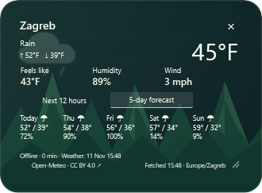

<p align="center">
  
</p>

<h1 align="center">WeatherWidget</h1>

<p align="center">
  A little weather for your Windows desktop.
</p>

<p align="center">
  
  
  
</p>

I got used to the little weather widgets on Windows 7, and for years I used XWidget for my forecast. When the old weather service stopped working, I decided to make a standalone widget for Windows 11. This is the result: a small Windows desktop companion built with C#, WPF and .NET 10. And no AI services at runtime—just the weather.

## Preview

Theme previews with sample weather. Backgrounds change with the weather and time of day.

| Modern | Classic | Aurora |
| --- | --- | --- |
|  |  |  |
| Paper | Sunset | Nordic |
|  |  |  |

Forest is shown with a sample temperature trend:



Click the card for hourly and five-day forecasts:


## Features

- **Seven themes:** Modern, Classic, Aurora, Paper, Sunset, Nordic and Forest.
- **Small card, expanded forecast:** a 130 × 67 card that expands to a 330 × 243 forecast view. Drag to move; resize from the lower-right corner. It stays out of the taskbar and can be recovered from the tray.
- **Forecasts at a glance:** current conditions, hourly forecast for the next 12 hours and a five-day forecast.
- **Useful details:** feels-like temperature, humidity, wind, daily high and low, precipitation chance, and a three-hour temperature trend. The trend is hidden when data is stale, offline or unavailable.
- **Locations:** search for a city and save up to ten locations. Only the active location is fetched.
- **Optional location discovery:** ask Windows for a one-time location or request an approximate city from ipapi.co. Both actions are explicit; review the result and choose Apply to use it. There is no automatic fallback or background location tracking.
- **Settings:** choose Croatian or English, temperature and wind units, appearance, desktop behavior and optional weather notifications. Settings changes support Apply and Cancel; notifications and startup with Windows are off by default.
- **Rain and weather reminders:** a rain-soon indicator plus optional rain, frost-risk and strong-wind notifications. Choose quiet hours in Settings; repeated reminders are limited to one per type per six hours.
- **Desktop controls:** lock the card, snap it to monitor work-area edges, choose always-on-top, or opt into startup with Windows.
- **Quiet background behavior:** designed for low background use with software rendering. Weather updates use Open-Meteo; no ads, AI services or background location tracking.

## Getting started

Download the latest portable Windows x64 build from [Releases](https://github.com/mgracanin/WeatherWidget/releases/latest), extract it, and run `WeatherWidget.exe`. Keep the `Assets` folder beside the executable. The package includes the .NET runtime, so the target PC does not need the .NET SDK or XWidget installed.

The widget starts in the notification area. Right-click it or its tray icon to open Settings and other quick actions. Startup with Windows is optional and off by default.

## Make it yours

Open **Settings…** from the card or tray menu:

| Section | What you can change |
| --- | --- |
| **Location & units** | Search cities, manage saved locations, discover a location, choose temperature/wind units and language. |
| **Appearance** | Preview all seven themes and adjust compact/forecast sizes independently. |
| **Desktop** | Lock position, snap to edges, stay on top, or start with Windows. |
| **Notifications** | Enable weather reminders and set quiet hours in your computer's local time. |

**Apply** saves and updates the widget. **Save and close** also closes Settings. **Cancel**, Escape or × discards edits since the last Apply. Preferences, the selected location and saved locations are restored on the next run. Data is stored in `%LOCALAPPDATA%\WeatherWidget`.

| Action | Result |
| --- | --- |
| Click the card | Open or close the forecast. |
| Drag the card | Move it; its position is remembered. |
| Drag a lower-right corner | Resize either window proportionally. |
| Ctrl + mouse wheel over the card | Adjust the compact size. |
| Drag the forecast header | Move the detailed window. |
| Escape, × or click outside the forecast | Close the forecast. |
| Double-click the tray icon | Recover the card on screen. |
| Right-click → Exit | Quit completely. |

Weather normally refreshes every 15 minutes. Network failures keep the last forecast with an offline label; older current readings are marked stale and eventually hidden. The trend arrow describes roughly three hours ahead: **↑ warming**, **↓ cooling**, **→ steady**. It is omitted when fresh forecast data is unavailable.
## Weather data and location privacy

Forecasts and city search use [Open-Meteo](https://open-meteo.com/). The selected city's coordinates are sent to the forecast service. City search uses Open-Meteo's geocoding service, based on GeoNames. See [NOTICE.md](NOTICE.md) for provider terms and artwork ownership information.

Location discovery does not run at startup or in the background. Windows discovery uses its permission controls. IP-based estimation contacts [ipapi.co](https://ipapi.co/) only when you choose that action; VPNs and ISP routing can make the estimate inaccurate. Discovery results are drafts until you apply them. See the [location guide](docs/locations.md) for permission help and method details.

## Build from source

You need Windows and the [.NET 10 SDK](https://dotnet.microsoft.com/download/dotnet/10.0). Clone the repository and run:

```powershell
git clone https://github.com/mgracanin/WeatherWidget.git
cd WeatherWidget
.\build.ps1 -Test -Publish
```

The script can also use a local SDK in `tools/dotnet` when available. The portable build is written under `artifacts/win-x64/`.

For an ordinary development build or just the checks:

```powershell
.\build.ps1
.\build.ps1 -Test
```

The tests use local weather/location fixtures and do not request your Windows location, contact the IP provider, or change your saved preferences. The Windows API integration builds automatically; no Windows App SDK application or XWidget installation is required.
